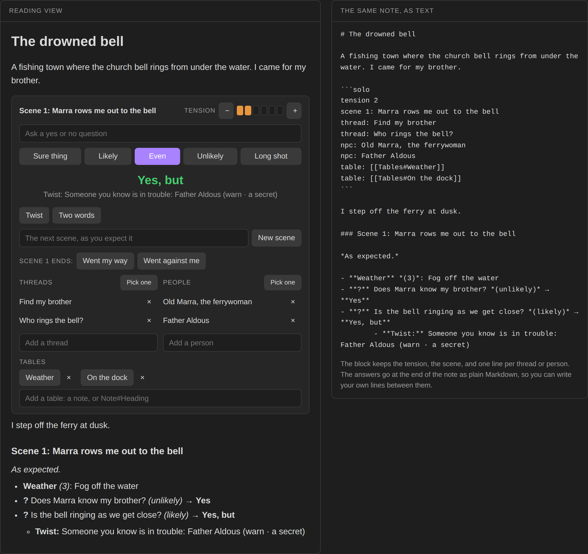

# Solo Oracle

Play tabletop games alone from a note. Ask the oracle yes or no at the odds you pick, frame the next scene and see if it goes as you expect, keep your threads and the people you meet, and get twists as the tension rises. Every answer writes itself into the note, so when you stop playing the note is the story.



**Try it in your browser** before installing: https://bulkhead.bananafest-destiny.com/press/solo-oracle/ runs the real plugin code over a sample note and shows the note's text growing as you play.

## Start a game

Run the command **Insert solo block**, or write one yourself:

````
```solo
tension 2
thread: Find my brother
npc: Old Marra, the ferrywoman
```
````

In reading view or live preview the block becomes a panel. The block keeps the state, one line each:

| Line | Meaning |
| --- | --- |
| `tension 2` | how wild things are, 0 to 6 (2 if left out) |
| `scene 3: The far shore` | the scene you are in |
| `thread: Find my brother` | something you want to happen or find out |
| `npc: Old Marra` | someone you have met |
| `table: [[Tables#Weather]]` | one of your own tables, with a button to roll on it |

Any other line is left alone, so you can keep notes to yourself in the block.

## Ask the oracle

Type a question and pick the odds: **Sure thing** (90% yes), **Likely** (70), **Even** (50), **Unlikely** (30) or **Long shot** (10). Enter asks at Even.

The answer is Yes or No. A roll far past the line makes it **Yes, and** or **No, and**; one close to the line makes it **Yes, but** or **No, but**. Every answer is possible at every odds.

Then a ten-sided tension die is rolled. At or under the tension, the answer comes with a **twist**: what happens (a thread moves closer, someone you know acts, something new steps in, and so on), who or what it is about, picked from your own threads and people, and two words to read into it.

**Twist** and **Two words** roll those on their own, for when you want a nudge without a question.

## Scenes

Type the scene you expect and press **New scene**. A ten-sided die against the tension decides how it goes:

- over the tension: **as expected**;
- at or under, odd: **changed**, with two words for how;
- at or under, even: **interrupted** by a twist.

When it ends, press **Went my way** (tension down one) or **Went against me** (up one). The more things go wrong, the stranger the story gets.

## Threads and people

Add them in the boxes under the panel, remove them with ×, and press **Pick one** to roll a random one. Twists pick from these lists too.

## Your own tables

Add a `table:` line with a link to a note, or to a heading in one, and the panel gets a button that rolls on it. Type `Tables#Weather` in the box under the panel, or write the line yourself. `[[Tables#Weather|Sky]]` names the button Sky.

What is under the link decides how it rolls:

| Under the link | A roll gives |
| --- | --- |
| a table whose first column is numbers or ranges (`1-2`, `3`, `4-6`) | the dice in that column's header (`d6`, `2d6`, `d20`) are rolled, or 1 to the highest number, and the matching row comes back with the roll |
| any other table | one row |
| a list | one item |
| anything else | one line |

```
## Weather

| d6 | Sky over the harbour |
| --- | --- |
| 1-2 | Still and grey |
| 3-4 | Fog off the water |
| 5-6 | A storm coming in |
```

A heading's part of the note runs to the next heading as high as it. The links sit inside a code block, so Obsidian doesn't update them when you rename a note; fix the line by hand if you do.

## The journal

Everything you roll goes at the end of the note as plain Markdown:

```
- **?** Is anyone at the dock? *(likely)* → **Yes, but**
	- **Twist:** Someone you know acts: Old Marra (betray · a promise)
- **Weather** *(3)*: Fog off the water

### Scene 2: Marra rows me to the church

*Interrupted. A thread moves closer: Find my brother (conceal · a key).*
```

Write your own lines between them. The panel only ever adds to the end of the note and edits its own block.

## Original tables

The odds, twist focuses and word lists were written for this plugin. None of them come from a published oracle, so the plugin works with any solo game and any setting.

## Privacy

Solo Oracle does not use the network, has no accounts, collects nothing and sends nothing. It only edits the `solo` block it is drawing and adds lines to the end of that note. It reads the notes your `table:` lines link to and never changes them.

## Install

From Obsidian: Settings → Community plugins → Browse → search "Solo Oracle".

By hand: copy `main.js`, `manifest.json` and `styles.css` from the latest release into `<your vault>/.obsidian/plugins/solo-oracle/`, then enable it under Community plugins.

## Also from this maker

- [Dice Tray](https://github.com/walkertbrown/dice-tray): rolls dice, random tables and note sections inline, and reads Dice Roller's `dice:` syntax.
- [Tabletop Clocks](https://github.com/walkertbrown/tabletop-clocks): segmented progress clocks, counters and stopwatches drawn from plain text.
- [Session Log](https://github.com/walkertbrown/session-log): a quick log for game night. Fights, rolls and clock ticks log themselves.
- [Quick Initiative](https://github.com/walkertbrown/quick-initiative): a light initiative tracker that lives as plain text in your note.

## Source

https://github.com/walkertbrown/solo-oracle

## Build

```
npm install
npm test
npm run build
```

MIT licensed.
